# FacetPDF Studio

FacetPDF Studio is an on-device PDF reader, editor, scanner, and converter for iPhone and iPad.

It is built for people who want to open, annotate, sign, organize, compress, and export PDF documents without sending private files to a remote document service.

## What It Does

- Read PDFs with fast navigation, zoom, search, and page tools.
- Annotate with ink, text, highlights, underline, strikeout, sticky notes, masks, signatures, and stamps.
- Scan paper documents into PDF using the device camera.
- Convert images, plain text, RTF, and HTML into PDF on device.
- Merge PDFs, create blank PDFs, organize pages, and export flattened copies.
- Compress and securely export documents while keeping files local to the device.
- Use Pro features through monthly, annual, or lifetime purchase options.

## Privacy Direction

FacetPDF Studio is designed around local document handling. Imported PDFs, camera scans, signatures, annotations, and converted files stay on the user's device unless the user chooses to share or export them through iOS.

No account is required.

## App Store Positioning

**Subtitle:** Read, edit & sign PDFs.

**Category:** Productivity

**Launch pricing direction:**

- Monthly Pro: USD 0.99
- Annual Pro: USD 4.99
- Lifetime unlock: USD 9.99

## Screenshots and Mockups

### Real iPhone 17 Pro Max Set

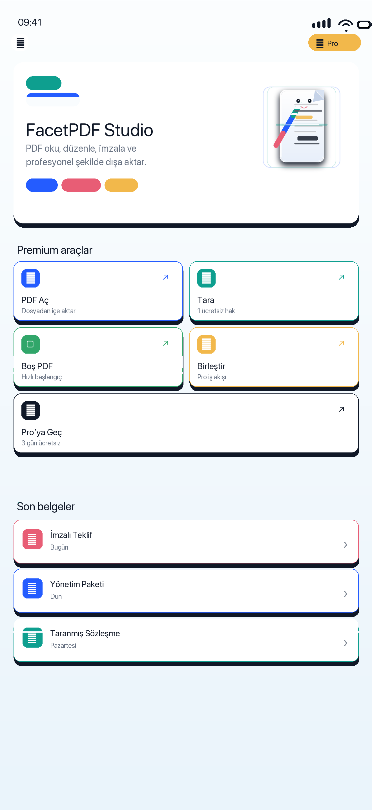
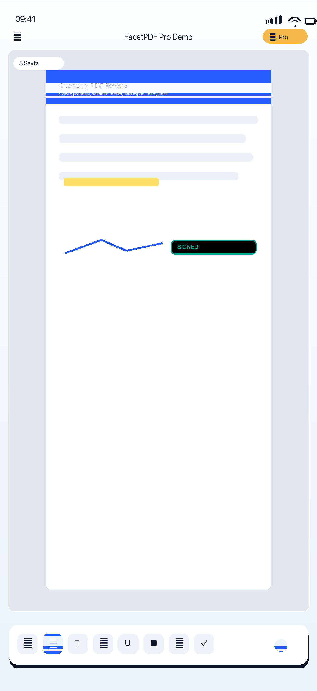

### App Store iPhone 6.5 Inch Set

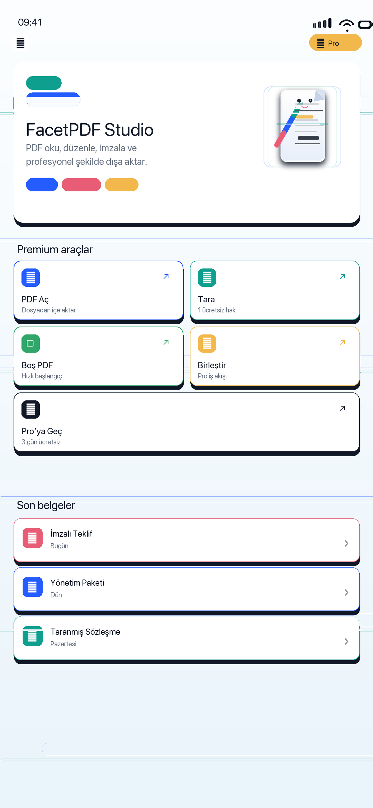
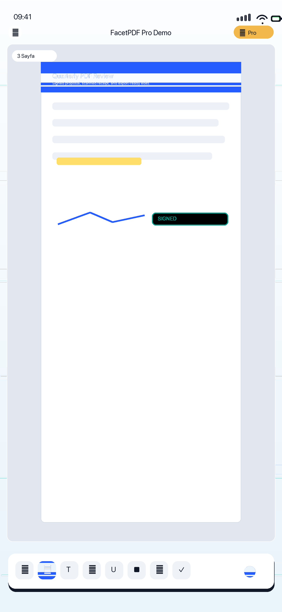
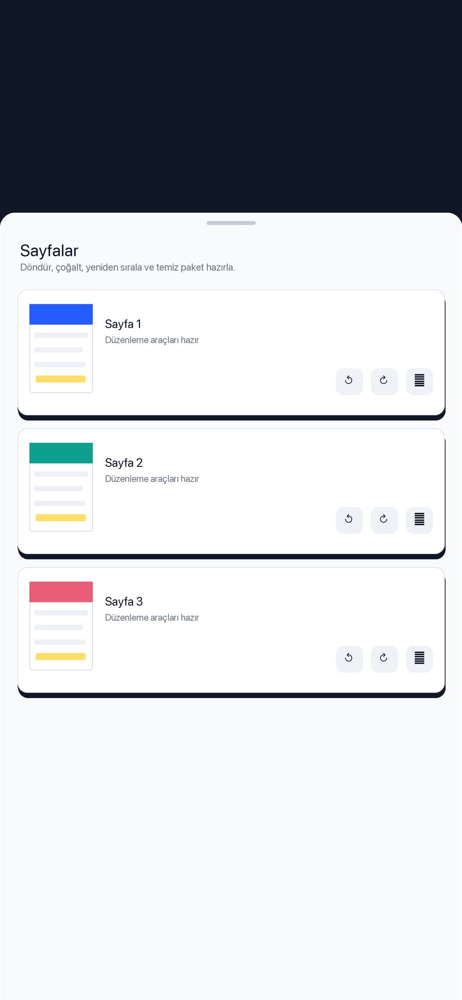
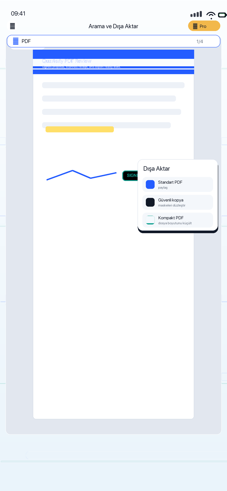
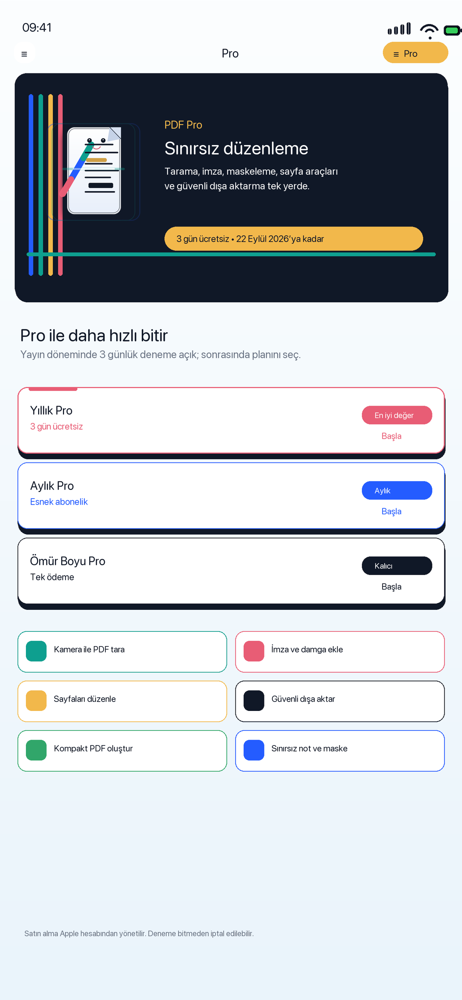

### iPad Set

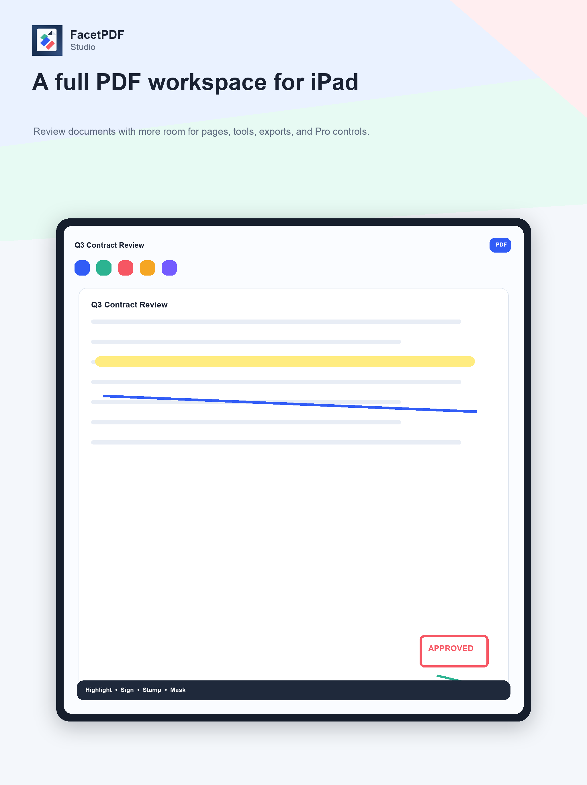
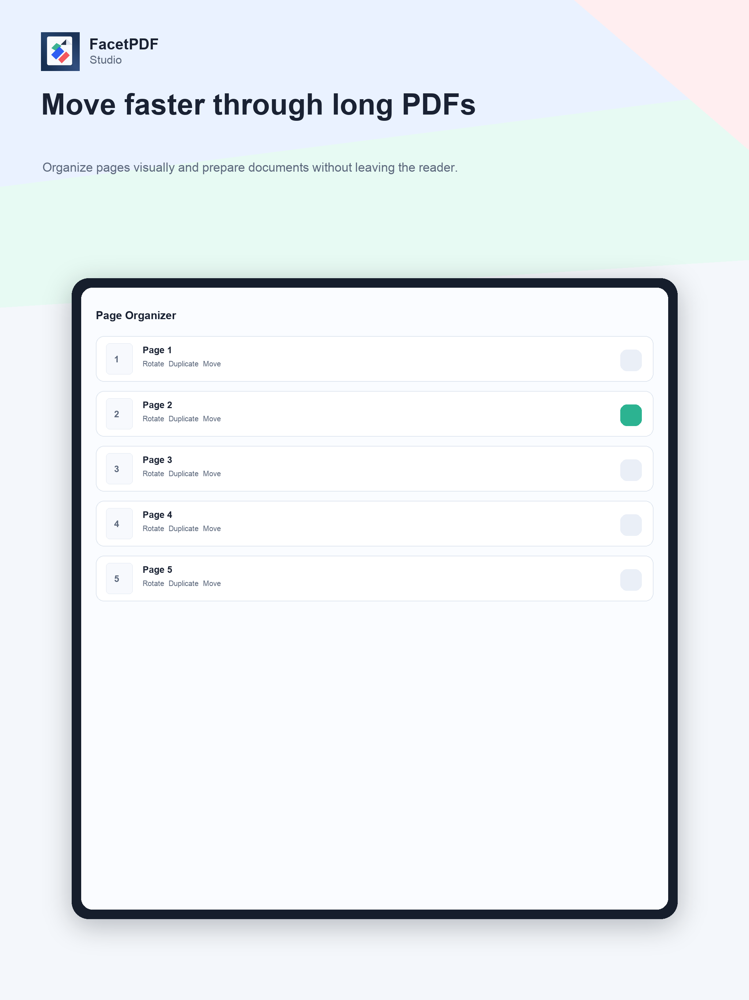
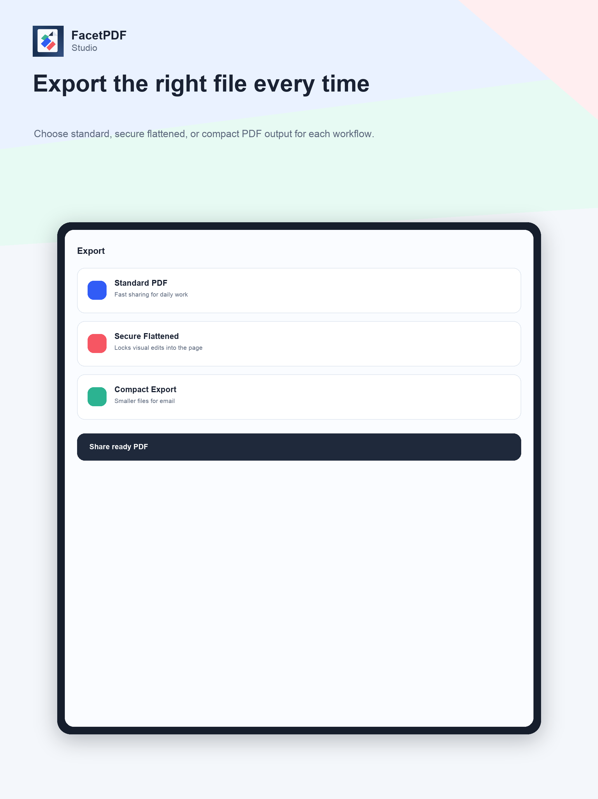
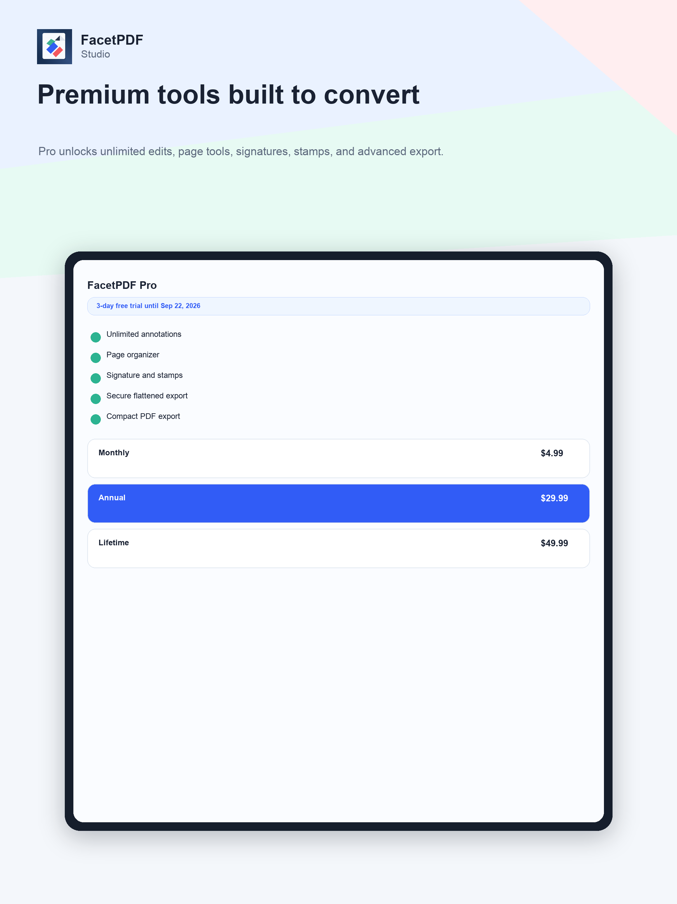

Turkish version: [README.tr.md](README.tr.md)
