<h1 align="center">FacetPDF Studio</h1>

  <strong>Read, edit, scan, sign and organize PDFs on iPhone and iPad.</strong> 
  A focused document workspace built around on-device processing.

  
  
  
  

## Product at a glance

| | |
| --- | --- |
| **Problem** | Everyday PDF jobs are often split across several tools or remote services. |
| **Solution** | One mobile workspace for reading, annotation, scanning, conversion and page management. |
| **Privacy direction** | Documents remain on the device unless the user explicitly shares or exports them. |
| **Business model** | Core experience with monthly, annual and lifetime Pro options. |

## Toolkit

- Fast PDF navigation, zoom, search and page tools
- Ink, text, highlights, notes, masks, signatures and stamps
- Camera scanning and blank-PDF creation
- Image, plain-text, RTF and HTML conversion
- Merge, reorder, rotate, delete and extract page workflows
- Compression, flattening and protected export options

## Product screens

<table>
  <tr>
    <td width="20%"></td>
    <td width="20%"></td>
    <td width="20%"></td>
    <td width="20%"></td>
    <td width="20%"></td>
  </tr>
</table>

  
<strong>View iPad previews</strong>

   
  
  
  
  

Türkçe anlatım: [README.tr.md](README.tr.md)
