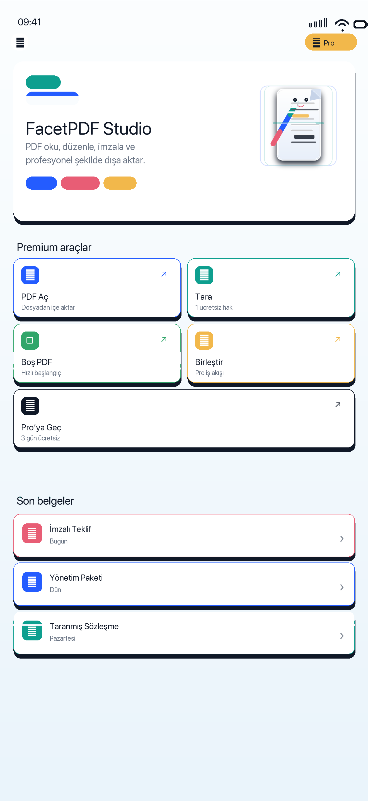
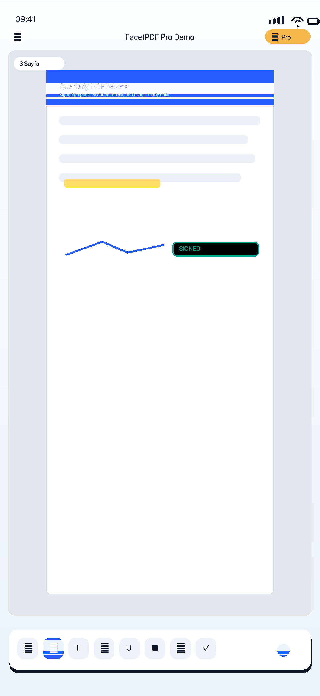
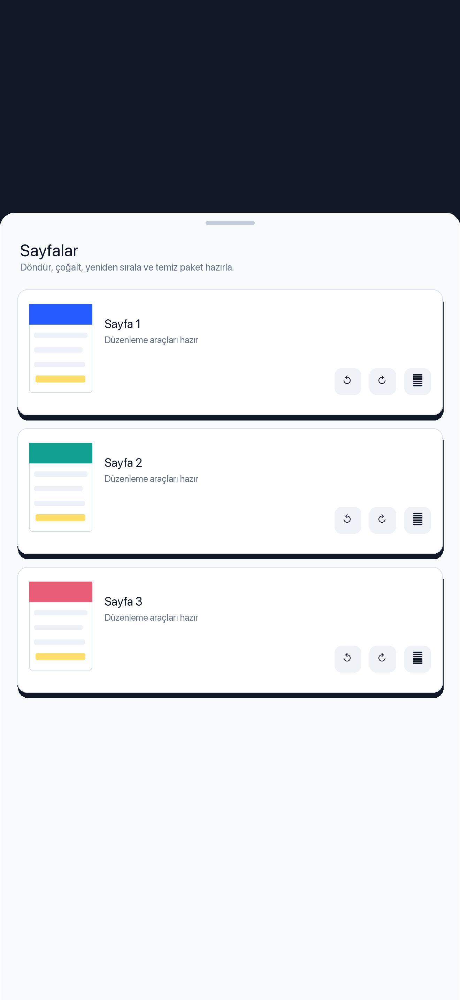
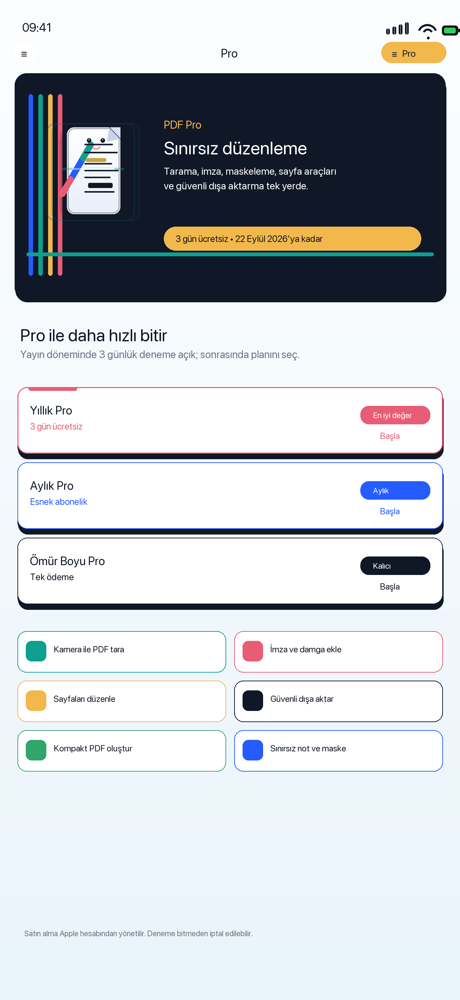
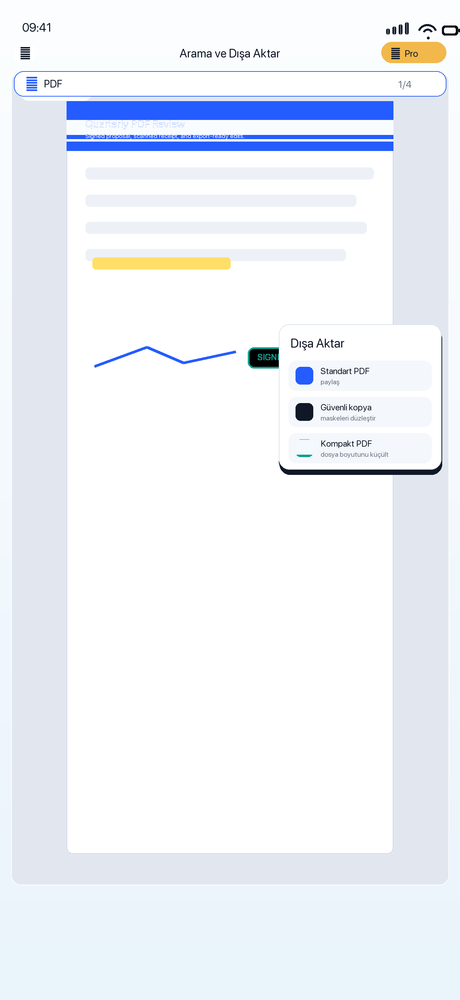

<h1 align="center">FacetPDF Studio</h1>

  <strong>iPhone ve iPad’de PDF okuma, düzenleme, tarama, imzalama ve sayfa yönetimi.</strong> 
  Cihaz üzerinde işlemeyi merkeze alan odaklı bir belge çalışma alanı.

  
  
  

## Ürün özeti

| | |
| --- | --- |
| **Problem** | Günlük PDF işlemlerinin farklı araçlara ve uzak servislere dağılması. |
| **Çözüm** | Okuma, not alma, tarama, dönüştürme ve sayfa yönetimini tek mobil çalışma alanında birleştirmek. |
| **Gizlilik yaklaşımı** | Belgeler, kullanıcı paylaşmayı veya dışa aktarmayı seçmedikçe cihazda kalır. |
| **Erişim** | Temel deneyim hesap gerektirmez; Pro için aylık, yıllık ve ömür boyu seçenekler bulunur. |

## Araç seti

- Hızlı gezinme, yakınlaştırma, arama ve sayfa araçları
- Kalem, metin, vurgu, not, maske, imza ve damga
- Kamera ile tarama ve boş PDF oluşturma
- Görsel, düz metin, RTF ve HTML’den PDF dönüştürme
- Birleştirme, sıralama, döndürme, silme ve sayfa çıkarma
- Sıkıştırma, sabitleme ve korumalı dışa aktarma

## Ürün ekranları

<table>
  <tr>
    <td width="20%"></td>
    <td width="20%"></td>
    <td width="20%"></td>
    <td width="20%"></td>
    <td width="20%"></td>
  </tr>
</table>

English: [README.md](README.md)
